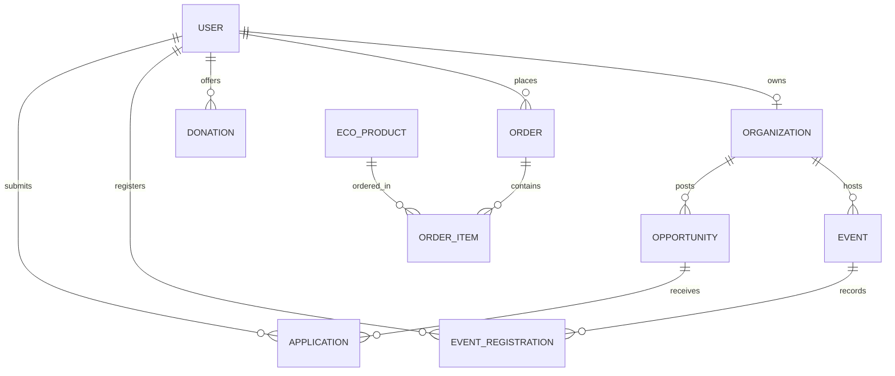

# GreenBridge – Full-Stack Community Impact & Sustainable Commerce Platform

> **Connecting Citizens, Verified NGOs, Local Sustainable Artisans, and Community Initiatives.**

GreenBridge is an enterprise-grade full-stack civic engagement and social impact platform designed to mobilize community participation across verified volunteering drives, physical donations, local sustainable commerce, and environmental initiatives. Built with **React 19**, **NestJS 11**, **Prisma ORM**, and **TypeScript**, GreenBridge features a **Deterministic Multi-Criteria Volunteer Recommendation Engine** based on Multi-Criteria Decision Making (MCDM) principles, live multi-role impact analytics, and strict Role-Based Access Control (RBAC).

---

## 🌟 Key Technical Highlights

1. **Deterministic Multi-Criteria Recommendation Engine**:
   - Solves the extreme cold-start and data sparsity problem ($\rho < 0.1\%$) inherent to localized volunteering networks.
   - Formulated as: $\text{MatchScore} = 0.35S + 0.30I + 0.20A + 0.15L$ (Skills, Interests, Availability, Location).
   - $100\%$ explainable (XAI): produces decomposed component percentages and natural-language rationales for every candidate opportunity.
   - See detailed mathematical specification: [DATA_SCIENCE_RECOMMENDATIONS.md](docs/DATA_SCIENCE_RECOMMENDATIONS.md).

2. **Dual-Mode Database Architecture (Hybrid Local/Cloud)**:
   - **Local Development / Offline Mode (`USE_MOCK_DATABASE=true`)**: Zero-setup, instant startup backed by a fully structured JSON database (`backend/db.json`) populated with 2,769 verified records.
   - **Production Cloud Mode (`USE_MOCK_DATABASE=false`)**: Enterprise MongoDB Atlas cluster (`greenbridgecluster`, database `greenbridge`) managed via Prisma ORM with connection pooling and typed schema enforcement.

3. **Regional Synthetic Dataset (Dehradun, Uttarakhand)**:
   - Includes **2,683 realistic synthetic records** across 10 collections reflecting realistic civic activity in Dehradun (Rajpur Road, Clement Town, Jakhan, Karanpur, Prem Nagar, Patel Nagar, Dalanwala).
   - Foreign key referential integrity ($100\%$ validated, 0 broken relations across users, NGOs, drives, applications, events, products, and orders).

4. **EcoCart Sustainable Commerce Marketplace**:
   - Direct-to-artisan marketplace empowering localized small eco-businesses.
   - Dual-channel checkout: records orders in the backend database while generating direct WhatsApp purchase dispatch messages with pre-formatted product specifications and subtotal breakdowns.

5. **Enterprise Role-Based Access Control (RBAC)**:
   - Distinct roles: `USER` (Citizen / Volunteer), `ORGANIZATION` (NGO Partner), and `ADMIN` (System Moderator).
   - Secured with signed JSON Web Tokens (JWT) and `bcrypt` password encryption.
   - Fully hardened against race conditions, out-of-order asynchronous responses, and unauthorized privilege escalation (verified via 17 automated regression tests).

6. **Live Analytical Impact Dashboards (Recharts)**:
   - **Volunteer Dashboard**: 6-month hours progression, category breakdown, completed drive history, and gamified XP progression.
   - **Organization Dashboard**: KPI summary cards, monthly applicant trend `AreaChart`, and campaign applicant distribution `BarChart`.
   - **Admin Dashboard**: Society impact metrics (Trees planted, volunteer hours, items donated), 6-month platform growth `AreaChart`, and NGO verification queues.

---

## 📚 Architectural & Viva Documentation

- 🔬 **[Data Science & Recommendation Engine Paper](docs/DATA_SCIENCE_RECOMMENDATIONS.md)**: Mathematical formulation, distance metrics, Jaccard similarity, XAI explainability heuristics, and academic IR evaluation metrics ($P@K$, MRR, NDCG).
- 🔐 **[Authentication Reliability, Lifecycle Trace & State Audit](docs/AUTH_LIFECYCLE_TRACE_AND_AUDIT.md)**: End-to-end 10-step lifecycle trace, state consistency audit, race-condition mitigation, and 17-test regression verification suite.
- 🎓 **[Viva Presentation & Defense Guide](docs/VIVA_PRESENTATION_GUIDE.md)**: Architectural diagrams, 5-stage scripted demo walkthrough, and Top 15 external examiner viva Q&As.

---

## 🛠 Technology Stack

| Layer | Technologies |
| :--- | :--- |
| **Frontend Client** | React 19, TypeScript, Vite, Tailwind CSS v4, Zustand 5, Recharts, Lucide Icons |
| **Backend REST API** | NestJS 11, TypeScript, Passport.js, JWT, Bcrypt, Class-Validator |
| **Data Persistence** | Prisma 6.2 ORM, MongoDB Atlas (`greenbridgecluster`), File-backed JSON Store (`db.json`) |
| **Security & Quality** | Strict RBAC Guards, Automated WCAG AA Contrast Auditing, Jest Test Suite |
| **Deployment** | Vercel (Frontend Client), Render (Backend Service), GitHub Monorepo |

---

## 🗄️ Database Architecture & Prisma Schema

The application models 14 domain entities within [`backend/prisma/schema.prisma`](backend/prisma/schema.prisma):



### Models Summary:
1. **User**: Credentials, role (`USER`, `ORGANIZATION`, `ADMIN`), XP, level, badges, interests, availability, location, and synthetic identifiers.
2. **Organization**: NGO profile, mission, verification status (`PENDING`, `APPROVED`, `REJECTED`), registration numbers, and owner link.
3. **Opportunity**: Volunteering campaigns, required skills, dates, required volunteers, and applicants count.
4. **Application**: Volunteer applications linking users to opportunities with live status tracking (`PENDING`, `ACCEPTED`, `REJECTED`).
5. **Event**: Community workshops and drives with location, capacity, dates, and registered user lists.
6. **EventRegistration**: Structured audit record linking users to events with custom registration form details.
7. **Donation**: Physical item donation marketplace (clothes, books, medical aids) with condition and collection status.
8. **MonetaryDonation**: Dedicated financial campaign contributions model (`amount_inr`, transaction mode, status).
9. **EcoProduct**: Eco-friendly store products, pricing, materials, environmental claims, and WhatsApp seller contacts.
10. **Order**: EcoCart order records with subtotal, delivery fee, payment mode, and fulfillment status.
11. **OrderItem**: Line-item breakdown linking orders to specific products and purchase quantities.
12. **Certificate**: Digital volunteer certificates issued upon drive completion.
13. **Notification**: In-app notifications with read status and timestamps.
14. **Badge**: Gamification badges rewarding community milestones and hours volunteered.

---

## 🗺️ Synthetic Dataset Details (Dehradun Region)

GreenBridge integrates a high-density synthetic dataset designed specifically to demonstrate realistic production scale during academic evaluations.

### Distribution of 2,683 Imported Synthetic Records:
- **Users (`users.json`)**: 400 volunteers and citizens across 15+ Dehradun localities.
- **NGOs (`ngos.json`)**: 80 organizations categorized into Environment, Education, Healthcare, Animal Welfare, and Disaster Relief.
- **Volunteering Opportunities (`opportunities.json`)**: 240 active, upcoming, and past community campaigns.
- **Volunteer Applications (`applications.json`)**: 500 applications across all lifecycle states.
- **Events (`events.json`)**: 150 community meetups, tree plantation drives, and cleanliness sessions.
- **Event Registrations (`event_registrations.json`)**: 250 registered attendee records.
- **EcoCart Products (`eco_products.json`)**: 120 sustainable handmade goods (bamboo products, cloth bags, seed paper).
- **Orders (`orders.json`)**: 180 customer orders.
- **Order Items (`order_items.json`)**: 363 line items.
- **Monetary Donations (`donations.json`)**: 400 financial contributions supporting community causes.

> ### ⚖️ Academic Synthetic Data Disclaimer Notice
> All names, telephone numbers, addresses, registration numbers (PAN / 12A / 80G), and monetary transactions contained in the synthetic dataset are entirely computer-generated and fictitious. Any resemblance to real individuals, active NGOs, or businesses in Dehradun is purely coincidental. The dataset was generated solely for academic evaluation, performance benchmarking, and user experience demonstration purposes.

---

## ⚡ Safe Seeding Engine (`prisma/seed.ts`)

The database seeding pipeline provides robust, idempotent data insertion:
1. **Deterministic ObjectId Mapping**: Synthetic string keys (e.g., `USR00001`, `NGO0001`) are transformed into valid 24-character hexadecimal MongoDB ObjectIds using MD5 hashing (`crypto.createHash('md5').update('${prefix}:${id}').digest('hex').slice(0, 24)`). This ensures $0\%$ hash collisions across all 2,683 records while guaranteeing repeat runs yield identical database references.
2. **Password Encryption**: All synthetic accounts are secured using `bcrypt` hashed credentials (`password123`), preserving the administrator (`admin123`) and demo user (`sonaa123`) accounts.
3. **Idempotence & Safety**: Uses upsert semantics (`upsert` / matching by `syntheticId`). Existing operational records are never dropped or overwritten.
4. **Dual Sync**: Populates both MongoDB Atlas (when `USE_MOCK_DATABASE=false`) and the local `backend/db.json` store (when `USE_MOCK_DATABASE=true`).

To execute the seed script:
```bash
# From repository root:
npm run seed

# Or directly in backend:
cd backend && npm run seed
```

---

## 🚀 Quick Start & Installation

### 1. Prerequisites
- **Node.js**: v18.0.0 or higher
- **npm**: v9.0.0 or higher

### 2. Clone and Install
```bash
git clone https://github.com/DivyaDubey06/Green-Bridge.git
cd Green-Bridge
npm run install:all
```

### 3. Environment Configuration
Create `backend/.env`:
```env
PORT=5000
USE_MOCK_DATABASE=true
DATABASE_URL="mongodb+srv://<username>:<password>@greenbridgecluster.mongodb.net/greenbridge?retryWrites=true&w=majority"
JWT_SECRET="greenbridge-super-secure-production-secret-key-2026"
```

Create `frontend/.env`:
```env
VITE_API_URL=http://localhost:5000
```

> **Note**: For instant local evaluation, keep `USE_MOCK_DATABASE=true`. The platform will load the entire 2,769-record dataset instantly without needing external database credentials or network access. To switch to live MongoDB Atlas, set `USE_MOCK_DATABASE=false` and provide your Atlas connection string in `DATABASE_URL`.

### 4. Running the Development Servers
```bash
# Starts both frontend (port 5173) and backend (port 5000) concurrently
npm run dev
```

- **Frontend Client**: `http://localhost:5173`
- **Backend API**: `http://localhost:5000`

---

## 🧪 Testing & Quality Verification

### Run Automated Backend Test Suite:
```bash
npm test
```
*Executes all 17 automated tests covering authentication lifecycle, token minting, role protection, out-of-order profile handling, privilege escalation prevention, and concurrency.*

### Run Production Builds:
```bash
# Test frontend production bundle (Vite + TypeScript)
npm run build --prefix frontend

# Test backend production compilation (NestJS + Prisma)
npm run build --prefix backend
```

### Run WCAG AA Contrast Audit:
```bash
node frontend/scripts/check-contrast.cjs
```

---

## 🔑 Evaluator & Demo Accounts

The database includes pre-configured accounts representing each system role:

| Role | Email | Password | Key Demonstration Capabilities |
| :--- | :--- | :--- | :--- |
| **Administrator** | `admin@greenbridge.org` | `admin123` | NGO verification, platform impact stats, user moderation, all-campaign control |
| **Verified NGO** | `sonaa@gmail.com` | `sonaa123` | Campaign creation, volunteer application approval/rejection, NGO analytics |
| **Volunteer (Citizen)** | Any synthetic user (e.g. `aarav.sharma@gmail.com`) | `password123` | Multi-criteria recommendations, campaign application, event signup, EcoCart |

---

## 🌐 Production Deployment Guide

### A. Backend on Render (`render.yaml`):
1. Connect the GitHub repository to [Render](https://render.com).
2. Create a new **Web Service** using the root directory.
3. Render automatically picks up [`render.yaml`](render.yaml):
   - **Build Command**: `npm install && npm install --prefix backend && npx prisma generate --schema=backend/prisma/schema.prisma && npm run build --prefix backend`
   - **Start Command**: `npm run start:prod --prefix backend`
4. Set Environment Variables in Render Dashboard:
   - `USE_MOCK_DATABASE`: `false`
   - `DATABASE_URL`: `mongodb+srv://<user>:<password>@greenbridgecluster.mongodb.net/greenbridge?retryWrites=true&w=majority`
   - `JWT_SECRET`: *(auto-generated or custom strong secret)*

### B. Frontend on Vercel:
1. Connect the GitHub repository to [Vercel](https://vercel.com).
2. Set **Root Directory** to `frontend`.
3. Configure settings:
   - **Framework Preset**: Vite
   - **Build Command**: `npm run build`
   - **Output Directory**: `dist`
4. Set Environment Variable:
   - `VITE_API_URL`: `https://<your-render-backend-url>.onrender.com`
5. The included [`frontend/vercel.json`](frontend/vercel.json) handles client-side SPA routing automatically.

---

## 📜 Academic Declaration & Evaluation

This project was developed for the **College Minor Project Evaluation**.  
Released under the [MIT License](LICENSE).
