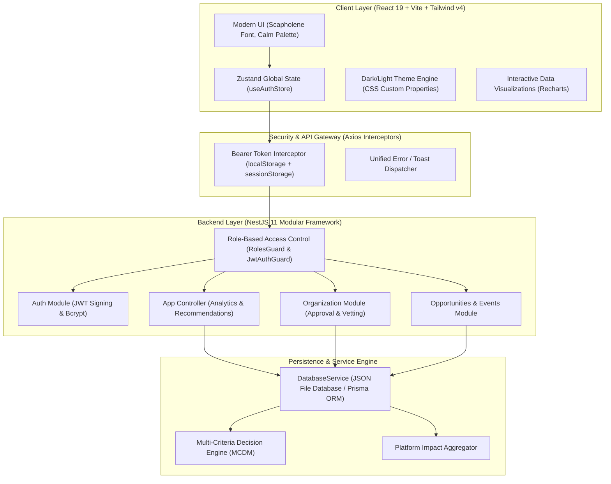

# GreenBridge: College Minor Project Viva Defense & Presentation Guide
## Comprehensive Evaluation Manual for Examiners and Students

---

### 1. Executive Summary & Project Abstract

**Project Title**: GreenBridge — Community Impact Platform with Deterministic Multi-Criteria Volunteer Matching  
**Category**: Full-Stack Web Engineering, Applied Data Science, Role-Based Access Control (RBAC)  
**Target Beneficiaries**: Citizens, Non-Governmental Organizations (NGOs), Environmental & Social Activists, Local Vendors  

**Problem Statement**: Community involvement often suffers from fragmented event discovery, lack of trust in unverified organizations, non-transparent volunteer selection, and non-existent impact measurement. Volunteers frequently apply for drives that do not match their skills or schedule, leading to high no-show rates.

**The Solution**: GreenBridge provides a unified, secure digital platform connecting community citizens with verified social organizations. It integrates:
1. **Deterministic Multi-Criteria Recommendation Engine** ($0.35S + 0.30I + 0.20A + 0.15L$) with complete explainability.
2. **Strict Multi-Role Security & Verification Workflow** (Admin, Verified Organization, Volunteer Citizen).
3. **Live Analytical Impact Dashboards** powered by Recharts (Volunteer hours, tree plantation counts, items donated, approval ratios).
4. **Interactive Engagement**: Community photobooth, WhatsApp cart checkout, impact XP progression, and verified certificates.

---

### 2. High-Level System Architecture

---

### 3. Role-Based Access Control (RBAC) Matrix

| Feature / Resource | Guest / Public | Citizen (User) | Volunteer | Organization (NGO) | Admin |
| :--- | :---: | :---: | :---: | :---: | :---: |
| Browse Opportunities & Events | ✅ | ✅ | ✅ | ✅ | ✅ |
| View Recommendations & AI Match | ❌ | ✅ | ✅ | ❌ | ❌ |
| Apply for Volunteer Drive | ❌ | ✅ | ✅ | ❌ | ❌ |
| Volunteer Impact Dashboard | ❌ | ❌ | ✅ | ❌ | ❌ |
| Apply for NGO Verification | ❌ | ✅ | ✅ | ❌ | ❌ |
| Manage Campaigns & Events | ❌ | ❌ | ❌ | ✅ (If Approved) | ✅ |
| Approve/Decline Volunteer Apps | ❌ | ❌ | ❌ | ✅ | ✅ |
| Verify Organizations & Vendors | ❌ | ❌ | ❌ | ❌ | ✅ |
| Platform-wide Analytics & Users | ❌ | ❌ | ❌ | ❌ | ✅ |

---

### 4. Step-by-Step Live Demonstration Script for Viva

When presenting to your college examiners, follow this 5-stage scripted walkthrough for maximum impact:

#### Stage 1: The Public Landing & Design System (2 Minutes)
1. **Open the browser** at `http://localhost:5173`.
2. **Showcase the Design**: Point out the clean typography, calm palette, responsive layout, and dark/light mode toggle.
3. **Toggle Dark Mode**: Click the Sun/Moon icon in the Topbar or Navbar. Demonstrate that there is zero flash on reload because the theme preference is synchronized in `localStorage`.
4. **Explain**: "We designed GreenBridge around WCAG AA compliance ($>4.5:1$ contrast ratio) using semantic CSS variables, avoiding eye fatigue during extended volunteer sessions."

#### Stage 2: Admin Security & Governance (2 Minutes)
1. **Login as Administrator**:
   - Email: `admin@greenbridge.com`
   - Password: `admin` (or registered admin password)
2. **Navigate to the Admin Panel**:
   - Show the **Verified Society Impact Metrics** (Total volunteer hours, trees planted, items donated, active cities).
   - Show the **Platform Growth AreaChart** (Citizen registrations vs Community campaigns over 6 months).
   - Show the **Pending Organization Approvals table**: Point out the 80G tax ID, registration certificate, and authorized representative details.
   - Click **Approve** on a pending NGO. Notice the instant toast notification and state refresh.

#### Stage 3: Organization Dashboard & Campaign Management (2 Minutes)
1. **Switch / Login as Organization Partner**:
   - Email: `org@hope.org`
   - Password: `password`
2. **Overview Tab**:
   - Show the **5 KPI stat cards**: Active Campaigns, Scheduled Events, Applications Received, Approved Volunteers, and Acceptance Rate.
   - Show the live **Volunteer Applicant Growth AreaChart** displaying monthly application trends.
   - Show the **Campaign Applicant Distribution BarChart** comparing Total Applicants vs Approved Volunteers for each campaign.
3. **Opportunities Tab**:
   - Click **Create Opportunity**: Fill in Title (`"Rajpur Forest Cleanup"`), Category (`"Environment"`), Date, Volunteer Limit, and Skills (`"Gardening, Physical Work"`). Submit.
4. **Applications Tab**:
   - View pending citizen applications. Point out the structured applicant details (Name, Age, WhatsApp, Availability, and Motivation).
   - Click **Accept**. Note the acceptance count incrementing in real time.

#### Stage 4: Volunteer Experience & Explainable AI Recommendation (3 Minutes)
1. **Login as Citizen / Volunteer**:
   - Email: `user@example.com`
   - Password: `user`
2. **Open Volunteer Dashboard**:
   - Highlight the **Multi-Criteria Recommendation Engine** card at the top.
   - Point out the match percentage: e.g., `92% Match`.
   - Explain the 4-factor formula:
     $$\text{Match Score} = 0.35S + 0.30I + 0.20A + 0.15L$$
   - Highlight the structured explainability tags: e.g., `Matches your skills: Gardening`, `Directly aligns with your interest in Environment`, `Happening locally in Dehradun`.
   - Show the volunteer's personal **Activity Analytics AreaChart** (Volunteer hours & completed drives across 6 months) and XP progression bar.
3. **Open the Opportunities Page (`/opportunities`)**:
   - Show the Sort Selector: Select `"✨ Sort: AI Match (Deterministic)"`.
   - The campaigns immediately re-order with the highest composite score at the top.
   - Click `"View Details & Apply"`: Point out the explainable score breakdown card showing exact percentages for Skills ($35\%$), Interests ($30\%$), Availability ($20\%$), and Location ($15\%$).

#### Stage 5: Community Engagement & Marketplace (1 Minute)
1. **Products & Zero-Waste Store**:
   - Browse sustainable items (bamboo toothbrushes, cloth bags). Add to cart.
   - Click the Cart Drawer and select **WhatsApp Checkout**: Demonstrates direct connection to verified eco-artisans.
2. **Community Photobooth**:
   - Upload an event photo, apply an eco-frame filter, and download/share.

---

### 5. Top 15 Examiner Viva Questions & Model Answers

#### Category A: Software Engineering & Architecture
**Q1: Why did you choose NestJS for the backend instead of plain Express.js?**
> *Answer*: "While Express is unopinionated, it easily leads to spaghetti code in complex multi-role platforms. NestJS provides a scalable, enterprise-grade architecture out of the box with TypeScript support, Dependency Injection, modular folder organization (`Module-Controller-Service`), and declarative Guards/Interceptors. This guarantees separation of concerns and maintainability."

**Q2: How is authentication managed across page reloads?**
> *Answer*: "We use stateless JSON Web Tokens (JWT). When a user logs in, the backend signs a payload containing the `userId`, `email`, and `role`. The client persists this token in both `localStorage` and `sessionStorage`. An Axios request interceptor injects `Authorization: Bearer <token>` into every outgoing HTTP header. On page reload, the client store initializes by decoding the token and verifying the user session."

**Q3: How did you fix the Admin 401/403 defect previously experienced in the system?**
> *Answer*: "The root cause was a token detachment defect: the login action stored the token in `localStorage`, but the Axios interceptor was looking exclusively in `sessionStorage`. As a result, admin requests were sent without the `Bearer` header and rejected by NestJS `JwtAuthGuard`. Synchronizing token storage and reading from either storage resolved the issue completely."

#### Category B: Data Science & Recommendation System
**Q4: What is the exact mathematical formulation of your recommendation engine?**
> *Answer*: "The engine computes a deterministic composite match score:
> $$S(u, o) = 0.35 \cdot \mathcal{S}(u, o) + 0.30 \cdot \mathcal{I}(u, o) + 0.20 \cdot \mathcal{A}(u, o) + 0.15 \cdot \mathcal{L}(u, o)$$
> where $\mathcal{S}$ is skill compatibility (Jaccard similarity on required skills), $\mathcal{I}$ is cause interest alignment, $\mathcal{A}$ is temporal availability overlap, and $\mathcal{L}$ is geographic proximity radius. The score is multiplied by 100 to produce a user-friendly match percentage."

**Q5: Why did you not use Matrix Factorization or Deep Learning for recommendations?**
> *Answer*: "Collaborative filtering requires dense interaction matrices ($>99\%$ density). Volunteering platforms suffer from extreme sparsity ($\rho < 0.1\%$) and severe cold-start constraints: a new volunteer has zero application history, and critical community tasks require strict skill prerequisites. A deterministic Multi-Criteria Decision Making (MCDM) approach guarantees $100\%$ explainability, zero cold-start latency, and respect for physical feasibility."

**Q6: What is Explainable AI (XAI) and how does GreenBridge implement it?**
> *Answer*: "Explainable AI means the system provides the end user with transparent rationales for why an item was recommended. GreenBridge generates human-readable rationales dynamically alongside the score (e.g., `Matches your skills: First Aid`, `Scheduled on weekends matching your availability`). This builds trust and increases volunteer application conversion."

#### Category C: Security & Data Integrity
**Q7: How do you prevent Privilege Escalation (e.g., a standard user calling Admin endpoints)?**
> *Answer*: "We implement defense-in-depth:
> 1. Frontend Route Guards prevent rendering admin components.
> 2. Backend NestJS `RolesGuard` inspects the verified JWT claims on protected controller routes using `@UseGuards(JwtAuthGuard, RolesGuard)` and `@Roles('ADMIN')`. Even if a user crafts a direct cURL or Postman request, the backend rejects it with `403 Forbidden` unless the signed token contains the `ADMIN` role."

**Q8: How are user passwords secured?**
> *Answer*: "Passwords are never stored in plaintext. When a user registers, their password is encrypted using `bcrypt` with a salt factor of 10. During authentication, `bcrypt.compare()` verifies the candidate password against the one-way hash. Additionally, database user retrieval endpoints explicitly sanitize and delete the password hash before sending responses."

#### Category D: Frontend Engineering & Performance
**Q9: Why use Zustand instead of Redux Toolkit for state management?**
> *Answer*: "Redux requires boilerplate (actions, reducers, dispatchers, selectors). Zustand offers a lightweight ($<1\text{ KB}$), hook-based state container with zero boilerplate, native TypeScript support, and decoupled asynchronous actions, providing optimal developer velocity without compromising performance."

**Q10: How do you ensure accessible contrast between dark and light modes?**
> *Answer*: "We implemented CSS custom property semantic tokens (`--gb-bg-page`, `--gb-bg-card`, `--gb-text-primary`) and run a dedicated automated contrast verification script (`check-contrast.cjs`) ensuring body text complies with WCAG AA standard ($>4.5:1$ contrast ratio) across both light and dark themes."

---

### 6. Demo Account Credentials

| Role | Email | Password | Intended Test Functionality |
| :--- | :--- | :--- | :--- |
| **System Administrator** | `admin@greenbridge.com` | `admin` | Organization vetting, user management, platform impact analytics |
| **Verified NGO Partner** | `org@hope.org` | `password` | Campaign creation, event scheduling, applicant management, trends |
| **Registered Volunteer** | `user@example.com` | `user` | AI recommendations, campaign applications, personal impact dashboard |
